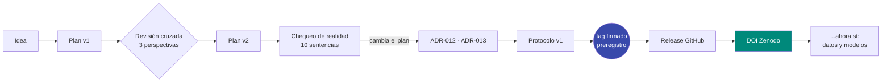
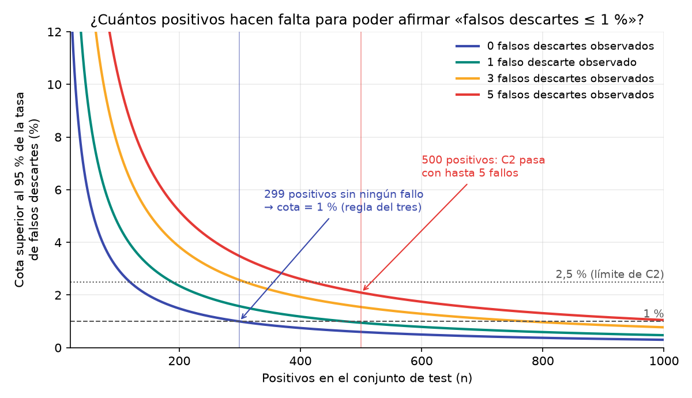

# Capítulo 0 · Cómo se organiza un experimento honesto

:brain: Crear un modelo · :hammer_and_wrench: Herramientas · :lock: Proteger datos

## ¿Qué vamos a hacer y por qué?

Antes de entrenar nada hay que decidir **qué pregunta** se va a responder, **cómo** se sabrá si la respuesta es «sí», «no» o «no se puede saber», y **dejarlo escrito con una fecha que nadie pueda cambiar**. Si no se hace así, es demasiado fácil, incluso sin mala fe, mirar los resultados y después elegir la métrica que mejor queda. En este capítulo se explica cómo lo hemos hecho en el Paso 0 y por qué cada pieza importa.

## Conceptos clave

### Preregistro :brain:

!!! example "Analogía"
    Es como un penalti en el que el delantero tiene que decir a qué lado va a tirar **antes** de chutar, delante de un notario. Si marca, nadie puede decir que ha tenido suerte, y si falla, tampoco puede decir «en realidad quería tirar al centro».

**Definición.** Un preregistro es un documento que fija **antes de ver ningún resultado** la pregunta, los datos que se usarán, las métricas, los umbrales de éxito y cómo se analizará todo. En este proyecto es el [protocolo](../protocolo.md), cerrado el 7-11-2026.

Lo que evita se llama ***p-hacking*** o «jardín de los senderos que se bifurcan»: probar muchas formas de medir hasta que una sale bien y contar solo esa.

### Tres veredictos, no dos :brain:

Un experimento pequeño muchas veces **no puede** decir ni que sí ni que no. Por eso cada criterio del protocolo tiene tres salidas: **pasa**, **no concluyente** y **no pasa**. «No concluyente» no es un fracaso: significa que los datos no bastan para afirmar nada, y decirlo así es más honesto que redondear a «sí».

### La regla del tres :brain:

!!! example "Analogía"
    Abres 10 yogures de un lote y ninguno está caducado. ¿Puedes afirmar que menos del 1 % del lote está caducado? No: con 10 yogures, como mucho puedes decir que menos del 30 % lo está. Para afirmar «menos del 1 %» tendrías que abrir unos 300 sin encontrar ninguno malo.

**Definición.** Si en *n* intentos independientes no observas ningún fallo, puedes afirmar con un 95 % de confianza que la tasa real de fallos es menor que **3/*n***. Es una aproximación de la **cota de Clopper-Pearson**, que da el valor exacto para cualquier número de fallos.

En este proyecto, el «fallo» que más nos importa es el **falso descarte**: un dato personal verdadero que el modelo decide no tapar. La primera versión del plan quería demostrar «≤ 1 % de falsos descartes» con unas 50 sentencias. La regla del tres decía que era imposible.

### Fecha que pone un tercero :hammer_and_wrench:

Un preregistro solo sirve si su fecha es creíble. Las fechas de git las pone el reloj de tu ordenador, así que se pueden falsificar. Por eso hay tres capas:

| Capa | Qué demuestra | Quién pone la fecha |
|---|---|---|
| **Commit y tag firmados** (SSH) | Que lo hizo el titular de esa clave y que nadie lo ha modificado | Tu ordenador |
| **Release de GitHub** | Que el fichero existía en esa fecha | El servidor de GitHub |
| **DOI de Zenodo** | Una copia archivada e inmutable, citable para siempre | Zenodo (CERN), un archivo científico independiente |

### Lo que no se publica :lock:

El repositorio es público, pero hay cosas que nunca entran: los textos de las sentencias (aunque sean públicas y estén disociadas), los contextos de los candidatos y los modelos entrenados. La razón está en el [ADR-008](../decisiones/ADR-008-que-se-publica.md): enlazar una fuente no es lo mismo que redistribuirla, y un modelo puede memorizar fragmentos de lo que ha visto.

## Visual principal

### Cómo se encadenan las piezas



Fíjate en el orden: el **chequeo de realidad va antes del preregistro**. Mirar 10 sentencias no es hacer trampa, porque no se entrena nada ni se mide ningún resultado del modelo. Solo se comprueba que el plan es realizable. Si se hubiera preregistrado antes, el umbral imposible habría quedado fijado con fecha y firma.

### Por qué hacen falta 500 positivos



Cada curva muestra lo más alto que podría ser la tasa real de falsos descartes según cuántos se hayan observado. Con pocos positivos (a la izquierda), aunque no haya ningún fallo, la cota es altísima. El criterio C2 exige que la cota quede por debajo del 2,5 %: con 500 positivos se cumple aunque haya hasta 5 falsos descartes.

## Cómo se hace

=== "Calcular la cota"

    ```python
    from scipy.stats import beta

    def cota_superior(k, n, alfa=0.05):
        """Cota superior unilateral de Clopper-Pearson: k fallos en n intentos."""
        return 1.0 if k >= n else beta.ppf(1 - alfa, k + 1, n - k)

    cota_superior(0, 300)   # 0.0099 -> 0,99 %
    cota_superior(5, 500)   # 0.0209 -> 2,09 %
    ```

    El script completo es [`tools/tamano_muestral.py`](https://github.com/noelserdna/pii-judge-es-poc/blob/main/tools/tamano_muestral.py).

=== "Firmar con SSH"

    ```bash
    # Decirle a git que firme con la clave SSH (solo en este repositorio)
    git config gpg.format ssh
    git config user.signingkey ~/.ssh/id_ed25519.pub
    git config commit.gpgsign true      # firma todos los commits
    git config tag.gpgsign true         # firma todos los tags

    # Registrar la clave en GitHub como clave de firma
    gh ssh-key add ~/.ssh/id_ed25519.pub --type signing
    ```

=== "Tag, Release y DOI"

    ```bash
    # 1. Tag firmado con el hash del protocolo en el mensaje
    git tag -s preregistro -m "Protocolo v1 cerrado. SHA-256: 0190bc4b…"
    git tag -v preregistro              # comprueba la firma
    git push origin preregistro

    # 2. Release: la fecha la pone GitHub
    gh release create preregistro --verify-tag --title "Preregistro del protocolo (v1)" \
        --notes "..." protocolo-v1.md

    # 3. El DOI llega solo: Zenodo escucha las Releases mediante un webhook
    ```

=== "Comprobarlo tú"

    ```bash
    git clone https://github.com/noelserdna/pii-judge-es-poc
    cd pii-judge-es-poc
    git show preregistro:docs/protocolo.md | sha256sum
    # debe dar 0190bc4b7b328b9dc1f0915d4b03fa1540b69dbbbf2443c818c0ea632c884fff
    ```

## Errores típicos y cómo los evitamos

| Error | Qué pasa | Cómo lo evitamos aquí |
|---|---|---|
| Preregistrar sin mirar los datos | Se fijan umbrales imposibles de verificar | Chequeo de realidad antes del protocolo ([bitácora del 7-11](../blog/posts/2026-11-07-chequeo-de-realidad.md)) |
| Contar todas las menciones como independientes | Una sola sentencia con un protagonista muy citado domina la métrica | Una mención por grupo ([ADR-012](../decisiones/ADR-012-unidad-de-anotacion.md)) |
| Elegir el mejor de varios entrenamientos | Se informa del resultado afortunado | Tres semillas fijas; se evalúa la **mediana** |
| Retocar el protocolo en silencio | El preregistro deja de valer | Todo cambio es una «desviación» pública en la bitácora |
| Dar por hecho que algo necesita permiso, o que no | Se bloquea el trabajo o se incumple una norma | Leer la norma y preguntar ([ADR-013](../decisiones/ADR-013-autorizacion-cendoj.md)) |

## Compruébalo tú

??? question "1. Sin ningún falso descarte en 120 positivos, ¿podemos afirmar «≤ 1 %»?"
    No. La regla del tres da 3/120 = 2,5 %: solo podemos afirmar que la tasa es menor del 2,5 %. Para afirmar «≤ 1 %» harían falta unos 300 positivos sin ningún fallo.

??? question "2. ¿Por qué el chequeo de realidad no rompe el preregistro?"
    Porque no mide ningún resultado del modelo: no hay modelo. Solo comprueba volúmenes (cuántos candidatos, cuántos se repiten, qué tipos aparecen) para que el protocolo sea realizable. Lo que un preregistro protege es la separación entre **decidir cómo medir** y **ver lo que sale**.

??? question "3. Si un tag de git ya tiene fecha, ¿para qué sirve el DOI?"
    La fecha del tag la pone el ordenador del autor y se puede falsear. La Release la fecha GitHub y el DOI la fecha Zenodo, un archivo científico independiente que además guarda una copia inmutable. Son terceros que no controla el autor.

## Para profundizar

- [Center for Open Science · ¿Qué es el preregistro?](https://www.cos.io/initiatives/prereg) (en inglés)
- [Zenodo · integración con GitHub](https://help.zenodo.org/docs/github/) (en inglés)
- [GitHub Docs · firmar commits con SSH](https://docs.github.com/es/authentication/managing-commit-signature-verification/about-commit-signature-verification)
