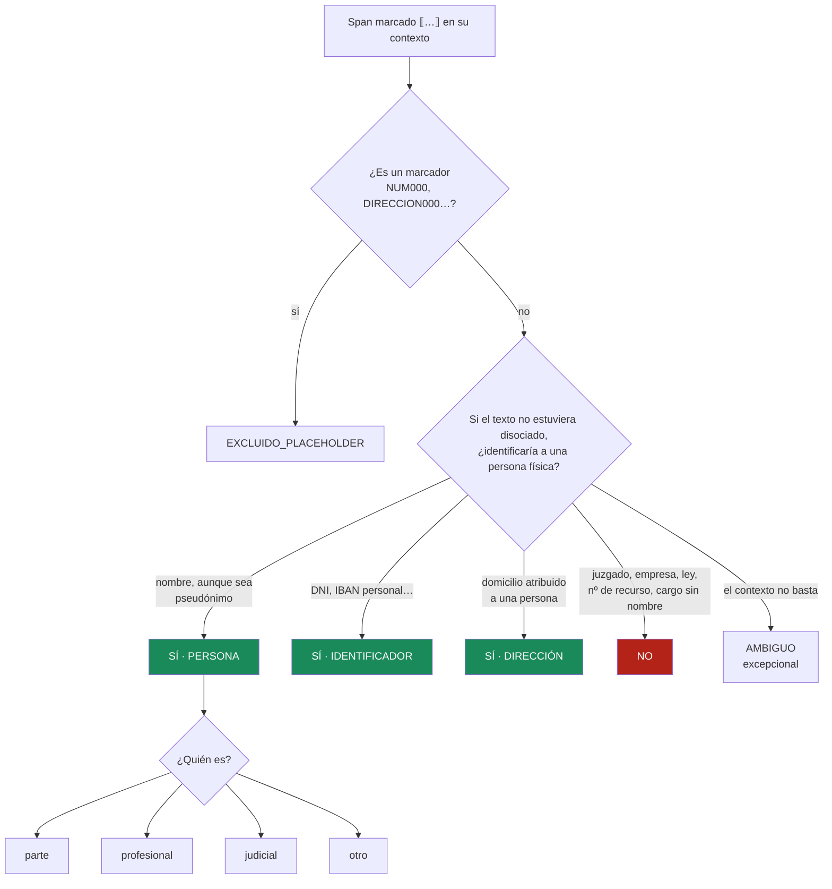

# Capítulo 1 · ¿Qué es un dato personal?

:lock: Proteger datos · :brain: Crear un modelo

## ¿Qué vamos a hacer y por qué?

Un modelo aprende lo que le enseñan las etiquetas. Si la etiqueta «dato personal» está mal definida, el modelo aprenderá esa definición equivocada con mucha precisión. En este capítulo veremos qué dice la ley, por qué en sentencias **ya disociadas** la pregunta literal da la respuesta contraria a la que queremos, y cómo se comprueba que una persona, o una máquina, aplica la definición de forma consistente.

## Conceptos clave

### Dato personal :lock:

!!! example "Analogía"
    Un dato personal es como una pieza de un puzle cuya imagen es una persona concreta. Una pieza suelta («una veterinaria») no dice quién es. Juntando tres («una veterinaria», «de un pueblo de Cuenca», «la única») ya se ve la cara. La ley protege también las piezas que, juntas, permiten reconstruir la imagen.

**Definición** (art. 4.1 del Reglamento General de Protección de Datos, RGPD): es *toda información sobre una persona física identificada o identificable*. Es identificable quien puede ser identificado **directa o indirectamente**, por ejemplo con un nombre, un número de identificación, datos de localización o elementos propios de su identidad física, económica, cultural o social.

El considerando 26 añade el criterio práctico: hay que tener en cuenta **los medios que razonablemente podrían utilizarse** para identificar a alguien. No basta con que sea imposible en teoría: tiene que ser poco razonable en la práctica.

| Tipo | Ejemplo inventado | ¿Identifica solo? |
|---|---|---|
| **Directo** | «Eulalia Martín Soria», «DNI 12345678Z» | Sí |
| **Indirecto (cuasi-identificador)** | «la única veterinaria de Villar del Humo» | Combinado con otros datos, sí |
| **No personal** | «el Juzgado de lo Social nº 2», «la Ley 7/2005» | No |

### Seudonimizar no es anonimizar :lock:

!!! example "Analogía"
    Cambiar el nombre de un personaje en una novela no lo convierte en otra persona: si el resto de la historia sigue igual, quien conozca los hechos lo reconoce.

- **Seudonimizar** (art. 4.5 RGPD): sustituir los identificadores directos por otros (*«D. Eutimio»*, *«NUM000»*) de forma que, sin información adicional, no se pueda atribuir el dato a nadie. **Los datos seudonimizados siguen siendo datos personales.**
- **Anonimizar:** que nadie, con medios razonables, pueda volver a identificar a la persona. Exige evaluar el **riesgo residual**, no solo cambiar nombres. La Agencia Española de Protección de Datos insiste en que son cosas distintas.

El CENDOJ hace una **disociación**: sustituye los nombres de las partes por otros nombres y los identificadores por marcadores. Es una forma de seudonimización.

### La regla contrafactual :brain:

Aquí está la trampa. En una sentencia disociada, «D. Eutimio» es un nombre **inventado** por el CENDOJ. Si la pregunta de anotación fuera la literal, «¿identifica a una persona?», la respuesta correcta sería *no*, y el modelo aprendería que **los nombres de las partes no son datos personales**. Es exactamente lo contrario de lo que debe aprender para trabajar después con documentos sin disociar.

Por eso la [guía](../guia-anotacion.md) hace otra pregunta:

> **Si este documento NO estuviera disociado, ¿este span identificaría a una persona física?**

No se juzga si el nombre concreto es real, sino **el papel que cumple** en el texto.

### Acuerdo entre anotaciones: κ de Cohen :brain:

!!! example "Analogía"
    Dos personas que tiran una moneda y dicen «sí» o «no» coincidirán la mitad de las veces sin pensar nada. Si casi todo es «no», coincidirán todavía más por pura costumbre. κ descuenta ese acuerdo «gratis».

**Definición:**

```text
κ = (po − pe) / (1 − pe)
```

donde **po** es la proporción de coincidencias observada y **pe** la que se esperaría por azar a partir de cuántas veces usa cada uno cada etiqueta. Con κ = 1 el acuerdo es perfecto; con κ = 0, no es mejor que el azar.

**Ejemplo real de este proyecto** (prueba ciega, 30 instancias):

- La IA dijo `NO` 22 veces, `SI` 7 y `AMBIGUO` 1. El humano dijo `NO` 23 y `SI` 7.
- po = 29/30 = 0,967.
- pe = (22·23 + 7·7) / 30² = 0,617.
- **κ = (0,967 − 0,617) / (1 − 0,617) = 0,91.**

Con el 96,7 % de coincidencias, κ baja a 0,91 porque buena parte del acuerdo era fácil: la mayoría de las instancias son `NO`.

### Sesgo de automatización :brain:

Si la herramienta muestra la respuesta de una máquina antes de que la persona decida, la persona tiende a **confirmarla**. En la primera prueba de este proyecto se aceptaron **60 sugerencias de 60**, con una mediana de 3,6 s cada una. Ese acuerdo del 100 % no medía nada. Por eso toda la anotación se hace en **modo ciego** ([ADR-015](../decisiones/ADR-015-anotacion-ciega.md)): primero se decide y después se ve la sugerencia.

## Visual principal

### Cómo decide quien anota



### Lo que hay en una sentencia real

Distribución de las 90 instancias de prueba, agrupadas y con una mención por grupo ([ADR-012](../decisiones/ADR-012-unidad-de-anotacion.md)):

| Qué era | Cuántas | Etiqueta |
|---|---|---|
| Nombres de partes (pseudónimos) | 4 | SÍ · parte |
| Nombres de abogados, procuradores y peritos | 7 | SÍ · profesional |
| Nombres de magistrados y fiscales | 4 | SÍ · judicial |
| Otras personas (una empleada de una empresa que es parte) | 1 | SÍ · otro |
| Teléfonos, correos, IBAN y direcciones **del juzgado** | 17 | NO |
| Números de sentencias, recursos, leyes y procedimientos | 21 | NO |
| Órganos, empresas y lugares genéricos | 17 | NO |
| Cargos y tratamientos sin nombre («Presidente», «Letrado», «Ilma.») | 5 | NO |
| Palabras corrientes, encabezados y trozos mal cortados («FALLAMOS», «Segundo») | 14 | NO |
| **Total** | **90** | |

Solo **16 de 90** candidatos (menos de 1 de cada 5) son datos personales, y todos los identificadores de contacto que encontró el detector eran del propio juzgado. Por eso hace falta un validador.

## Cómo se hace

=== "La pregunta, en el anotador"

    ```text
    ¿Es dato personal?  ⟦Dª Carmen Ortiz⟧
    …representada por la Procuradora ⟦Dª Carmen Ortiz⟧ y asistida por el Letrado…

    [S] SÍ    [N] NO    [A] AMBIGUO    [M] MARCADOR
    Categoría: PERSONA   Rol: [1] parte [2] profesional [3] judicial [4] otro
    ```

    El anotador (`tools/anotador/`) funciona solo en `127.0.0.1`: el texto no sale del ordenador.

=== "Calcular κ"

    ```python
    from collections import Counter

    def kappa(a, b):
        n = len(a)
        po = sum(x == y for x, y in zip(a, b)) / n            # acuerdo observado
        ca, cb = Counter(a), Counter(b)
        pe = sum(ca[k] * cb[k] for k in ca.keys() | cb.keys()) / n**2  # acuerdo por azar
        return (po - pe) / (1 - pe)
    ```

=== "Agrupar menciones"

    ```python
    from src.annotate.muestreo import normalizar_span

    normalizar_span("Sra. Agustina ")   # 'agustina'
    normalizar_span("El Sr. Teodosio")  # 'teodosio'
    # Todas las menciones de «Teodosio» en un documento forman un solo grupo
    # y se anota UNA de ellas, elegida al azar.
    ```

## Errores típicos y cómo los evitamos

| Error | Cómo lo evitamos |
|---|---|
| Etiquetar «no» los pseudónimos porque son inventados | Regla contrafactual |
| Mezclar «es dato personal» con «hay que taparlo» (magistrados) | Se etiqueta SÍ y el `rol` permite separar después; tapar o no es una decisión de política |
| Usar `AMBIGUO` como cajón para lo difícil | Solo si el contexto no permite decidir; «no consta que sea de una persona» es `NO` |
| Dejar vacío un campo que luego hace falta | La herramienta no deja guardar sin `rol` |
| Mostrar la respuesta de la IA antes de decidir | Modo ciego ([ADR-015](../decisiones/ADR-015-anotacion-ciega.md)) |

## Compruébalo tú

??? question "1. «…la vivienda de DIRECCION000, propiedad de D. Eutimio…». ¿Cómo se etiquetan «DIRECCION000» y «D. Eutimio»?"
    «DIRECCION000» es un marcador → `EXCLUIDO_PLACEHOLDER`. «D. Eutimio» es un pseudónimo en el papel de nombre de una parte → `SI`, PERSONA, parte.

??? question "2. Dos anotadores coinciden en el 95 % de 100 casos, pero el 94 % de los casos son «NO». ¿Es buen acuerdo?"
    No necesariamente. Si los dos dicen casi siempre «NO», pe es muy alto (≈ 0,89) y κ puede quedarse en torno a 0,5. Por eso se informa κ y no solo el porcentaje.

??? question "3. ¿Seudonimizar un documento lo saca del RGPD?"
    No. Los datos seudonimizados siguen siendo datos personales (art. 4.5 y considerando 26 del RGPD). Solo la anonimización efectiva, evaluando el riesgo de reidentificación, lo saca.

## Para profundizar

- [Reglamento (UE) 2016/679 (RGPD), arts. 4.1 y 4.5 y considerando 26](https://eur-lex.europa.eu/legal-content/ES/TXT/?uri=CELEX:32016R0679)
- [AEPD · 10 malentendidos sobre la anonimización](https://www.aepd.es/guias/10-malentendidos-anonimizacion.pdf)
- [Cohen (1960), el artículo original del κ](https://doi.org/10.1177/001316446002000104) (en inglés)
