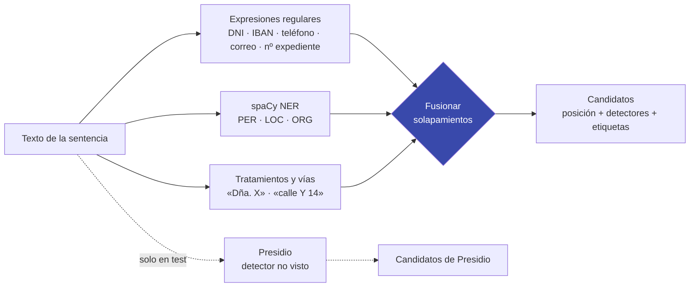
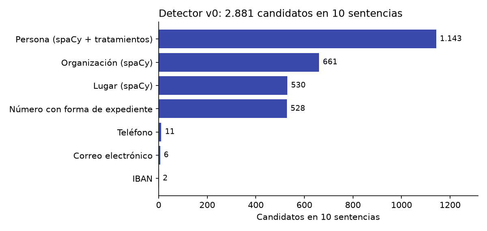

# Capítulo 2 · Cómo se encuentran candidatos

:brain: Crear un modelo · :hammer_and_wrench: Herramientas · :lock: Proteger datos

## ¿Qué vamos a hacer y por qué?

El validador no busca datos personales: juzga los que le pasa un **detector**. Por eso el detector tiene que ser **exagerado**, es decir, marcar todo lo que *podría* ser un dato personal, aunque se equivoque muchas veces. Lo que el detector no ve, el validador nunca lo recuperará. En este capítulo construimos ese detector con tres herramientas (expresiones regulares, reconocimiento de entidades y reglas de tratamiento) y vemos cómo se combinan.

## Conceptos clave

### Sensibilidad frente a precisión :brain:

!!! example "Analogía"
    Un detector de metales en un aeropuerto pita con las llaves, los cinturones y los empastes. Es molesto, pero se acepta porque **no puede dejar pasar un arma**. Después, una persona revisa lo que pitó. Nuestro detector es el arco; el validador, la persona que revisa.

- **Sensibilidad (recall):** de todos los datos personales que hay, ¿cuántos encuentra el detector? Queremos que sea muy alta.
- **Precisión:** de todo lo que marca, ¿cuánto es de verdad dato personal? Aquí puede ser baja, porque la sube el validador.

En el chequeo de realidad, menos de 1 de cada 5 candidatos era un dato personal: precisión baja, como se esperaba.

### Expresiones regulares y dígitos de control :hammer_and_wrench:

Una **expresión regular** describe la forma de un texto. `\b\d{8}[A-Z]\b` significa «8 dígitos seguidos de una letra, como palabra suelta», que es la forma de un DNI.

Muchos identificadores llevan un **dígito de control** para detectar errores de tecleo:

=== "DNI / NIE (módulo 23)"

    La letra del DNI es el resto de dividir el número entre 23, buscado en una tabla:

    ```text
    12345678 mod 23 = 14   →   tabla "TRWAGMYFPDXBNJZSQVHLCKE"[14] = Z   →   12345678Z ✔
    ```

    Para el NIE, la X, la Y y la Z iniciales se sustituyen por 0, 1 y 2 antes de calcular.

=== "IBAN (módulo 97)"

    Se pasan los 4 primeros caracteres al final, se convierten las letras en números (A = 10 … Z = 35) y el resultado, leído como un número enorme, tiene que dar resto 1 al dividirlo entre 97.

!!! warning "Por qué no descartamos los DNI con letra incorrecta"
    Un DNI mal tecleado en una sentencia **sigue identificando a alguien**. El detector marca `DNI_NIE_valido` o `DNI_NIE_invalido` y deja la decisión al validador. Si se descartara aquí, nadie lo recuperaría.

### Reconocimiento de entidades nombradas (NER) :brain:

Un modelo de **NER** lee una frase y marca los trozos que son nombres de persona (PER), lugares (LOC) u organizaciones (ORG). Usamos `es_core_news_lg` de spaCy, entrenado con noticias en español. Comete errores muy reveladores en sentencias:

| Lo que vio | Lo que dijo | Por qué |
|---|---|---|
| «FALLAMOS» | persona | Palabra en mayúsculas al principio de una línea |
| «Guadalupe» (una acusada) | lugar | También es una localidad |
| «la Ley» | lugar | Patrón «la + Mayúscula» |

No es un fallo que haya que corregir: son los falsos positivos que el validador tiene que aprender a descartar.

### Fusionar lo que se solapa :brain:

Tres detectores pueden marcar el mismo nombre con bordes distintos: spaCy marca «Eulalia», la regla de tratamientos marca «Eulalia Martín» y la expresión regular no ve nada. Si no se fusionan, el validador vería tres candidatos para una sola persona, y la evaluación contaría tres veces el mismo acierto o el mismo error.

## Visual principal

### De la sentencia a la lista de candidatos



### Cómo funciona la fusión

```text
texto:      …representada por Dña. Eulalia Martín Soria, con DNI…
spaCy:                             [Eulalia Martín]          PER
tratamiento:                       [Eulalia Martín Soria]    PER
                                   ─────────────────────
resultado:                         [Eulalia Martín Soria]    detector=[spacy, tratamiento]  etiqueta=[PER]
```

Regla ([ADR-004](../decisiones/ADR-004-detector.md)): los candidatos que se solapan, aunque sea en un carácter, forman un bloque. Del bloque sale **uno solo**, con el span más largo, la unión de detectores y etiquetas y el *score* máximo.

### Qué encuentra en sentencias reales



Con la fusión, los 2.881 candidatos del detector v0 se quedan en **2.590** en el detector definitivo.

## Cómo se hace

=== "Uso"

    ```python
    from src.detector.run import detectar_documento

    texto = "Comparece Dña. Eulalia Martín, con DNI 12345678Z, en el recurso 312/2024."
    for c in detectar_documento("ejemplo", texto):
        print(c["span"], c["detector"], c["det_label"], c["score"])
    # Eulalia Martín  ['spacy', 'tratamiento']  ['PER']               0.8
    # 12345678Z       ['regex']                 ['DNI_NIE_valido']    0.9
    # 312/2024        ['regex']                 ['NUM_EXPEDIENTE']    0.5
    ```

=== "Comprobar la letra del DNI"

    ```python
    LETRAS = "TRWAGMYFPDXBNJZSQVHLCKE"

    def dni_valido(s):
        num = s[:-1].replace("X", "0").replace("Y", "1").replace("Z", "2")
        return num.isdigit() and LETRAS[int(num) % 23] == s[-1]

    dni_valido("12345678Z")  # True
    dni_valido("X1234567L")  # True (NIE)
    ```

=== "Fusionar"

    ```python
    def fusionar(cands):
        cands = sorted(cands, key=lambda c: (c.start, -c.end))
        bloques, fin = [[cands[0]]], cands[0].end
        for c in cands[1:]:
            if c.start < fin:          # se solapa con el bloque actual
                bloques[-1].append(c)
                fin = max(fin, c.end)
            else:                      # empieza un bloque nuevo
                bloques.append([c])
                fin = c.end
        return [max(b, key=lambda c: c.end - c.start) for b in bloques]
    ```

    La versión completa (`src/detector/merge.py`) une además detectores, etiquetas y *scores*.

=== "Línea de comandos"

    ```bash
    uv run --group detector python -m src.detector.run \
        --entrada carpeta_con_txt/ --salida candidates.jsonl
    # --presidio para usar Presidio (solo en documentos de test)
    ```

## Errores típicos y cómo los evitamos

| Error | Cómo lo evitamos |
|---|---|
| Afinar el detector para que «acierte más» | Su trabajo es **no dejarse nada**. La precisión la aporta el validador |
| Descartar identificadores con el dígito de control mal | Se marcan como `_invalido`, no se borran |
| Contar varias veces el mismo nombre con bordes distintos | Fusión de solapamientos |
| Evaluar el validador con candidatos del mismo detector con el que se entrenó y creer que generaliza | Presidio solo en test, como **detector no visto** (análisis exploratorio) |
| Un patrón demasiado estricto («teléfono/fax» sin espacios) | Probar el detector sobre texto real antes de cerrarlo |

## Compruébalo tú

??? question "1. ¿Es válido el DNI 00000000T?"
    Sí: 0 mod 23 = 0, y la posición 0 de la tabla es la T.

??? question "2. spaCy marca «Sala» como lugar en «esta Sala acuerda…». ¿Hay que añadir una regla para que no lo marque?"
    No. Es un falso positivo del detector, y es justo lo que el validador tiene que aprender a descartar. Si el detector lo ocultara, el validador no aprendería nada de él y la medida del proyecto (cuántos falsos positivos elimina el validador) dejaría de ser honesta.

??? question "3. ¿Por qué Presidio se usa solo en test?"
    Para medir qué pasa cuando el validador recibe candidatos de un detector **que no vio al entrenar**, con otra forma de cortar los spans y otras etiquetas. Si también se usara en entrenamiento, esa prueba perdería sentido.

## Para profundizar

- [spaCy · reconocimiento de entidades](https://spacy.io/usage/linguistic-features#named-entities) (en inglés)
- [Microsoft Presidio](https://microsoft.github.io/presidio/) (en inglés)
- [Ministerio del Interior · cálculo de la letra del DNI](https://www.interior.gob.es/opencms/es/servicios-al-ciudadano/tramites-y-gestiones/dni/calculo-del-digito-de-control-del-nif-nie/)
