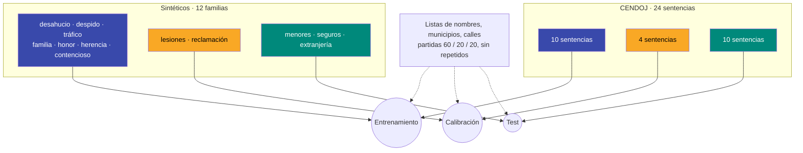

# Capítulo 3 · Datos para enseñar y datos para examinar

:brain: Crear un modelo · :lock: Proteger datos · :hammer_and_wrench: Herramientas

## ¿Qué vamos a hacer y por qué?

Un modelo se entrena con unos datos y se examina con otros. Si el examen se parece demasiado a lo estudiado, el modelo aprueba sin haber aprendido. En este capítulo veremos cómo se fabrican datos sintéticos con etiqueta exacta, cómo se reparten en **entrenamiento, calibración y test** sin que se cuele nada de uno en otro, y por qué ese reparto se hace **antes** de mirar ningún resultado.

## Conceptos clave

### Tres conjuntos con tres funciones :brain:

!!! example "Analogía"
    Un estudiante hace ejercicios (**entrenamiento**), un simulacro para saber cuánto puede arriesgar en el examen (**calibración**) y el examen final (**test**), que no ha visto nunca. Si el examen final reutiliza los ejercicios, la nota no dice nada.

| Conjunto | Para qué sirve | Quién lo ve |
|---|---|---|
| **Entrenamiento** | Ajustar los pesos del modelo | El modelo, muchas veces |
| **Calibración** | Fijar el umbral τ que deja los falsos descartes por debajo del 1 % | Solo para elegir τ; nunca para elegir hiperparámetros |
| **Test** | Medir los criterios C1–C3 | Una sola vez, al final |

### Fuga de datos (*data leakage*) :brain:

Hay fuga cuando información del test se cuela en el entrenamiento, aunque sea de forma indirecta. Las tres fugas que este proyecto bloquea:

1. **Mismo documento en dos conjuntos.** Si una sentencia aporta candidatos a entrenamiento y a test, el modelo ya conoce los nombres y el estilo de ese documento. → Se reparte **por documento**, no por candidato.
2. **Misma plantilla en dos conjuntos.** Un modelo puede memorizar «después de *con DNI* viene un dato personal» de una plantilla concreta. → Las familias de plantillas van **enteras** a un solo conjunto.
3. **Mismo nombre en dos conjuntos.** Si «Eulalia» sale en entrenamiento y en test, el modelo puede acertar por haberla visto. → Las listas de nombres, municipios y calles se **parten en tres trozos disjuntos**.

### Datos sintéticos con etiqueta por construcción :brain: :lock:

!!! example "Analogía"
    Para comprobar si alguien sabe encontrar errores en un texto, lo más fiable es escribir tú el texto y meter los errores a propósito: sabes exactamente dónde están.

Se escriben plantillas de documentos judiciales con **huecos tipados**:

```text
Dña. {{NOMBRE_COMPLETO_F:SI:PERSONA:parte}}, con DNI {{DNI:SI:IDENTIFICADOR:}},
recurre la resolución del expediente {{EXP:NO}} del Ayuntamiento de {{MUNICIPIO:NO}}.
```

Al rellenarlos se sabe la posición exacta de cada dato y si es personal. Ventajas: la etiqueta es exacta y no hay ningún dato real, así que **se puede publicar entero**. Riesgo: el texto sintético puede ser distinguible del real por detalles («Dña. Tomás»), y el modelo aprende esos detalles en lugar de la tarea. Por eso hay una **sonda de dominio** en la evaluación.

### Pares contrastivos :brain:

El mismo tipo de dato en dos contextos opuestos, para que el modelo no pueda decidir solo por la forma:

| Contexto | Etiqueta |
|---|---|
| «con DNI 12345678Z, compareció…» | SÍ |
| «en el expediente 1408/2025…» | NO |
| «podrá llamar al teléfono 657 578 345» (el padre) | SÍ |
| «Teléfono: 975 000 111 · Correo: juzgado2…» (cabecera) | NO |
| «la única veterinaria de Garcinarro» | SÍ |
| «la ciudad de Soria cuenta con varias oficinas» | NO |

## Visual principal

### Qué va a cada conjunto



### El corpus sintético en cifras

| Partición | Familias | Documentos | Candidatos | Positivos |
|---|---|---|---|---|
| Entrenamiento | 7 | 173 | 2.548 | 1.001 |
| Calibración | 2 | 60 | 784 | 324 |
| Test | 3 | 80 | 1.222 | 481 |

El protocolo exige al menos 300 positivos en calibración y 450 en test (ver la [regla del tres](00-experimento-honesto.md)): el generador produce documentos hasta superarlos.

## Cómo se hace

=== "Partir una lista sin solapes"

    ```python
    def partir(lista):
        """60 % / 20 % / 20 %, determinista: el mismo nombre cae siempre en el mismo trozo."""
        trozos = {"train": [], "cal": [], "test": []}
        for i, x in enumerate(sorted(set(lista))):
            r = i % 5
            trozos["train" if r < 3 else "cal" if r == 3 else "test"].append(x)
        return trozos
    ```

=== "Comprobar que no hay fugas"

    ```python
    import itertools

    def test_gazetteers_disjuntos_por_particion():
        for nombre, partes in GAZ.items():
            for a, b in itertools.combinations(["train", "cal", "test"], 2):
                assert not set(partes[a]) & set(partes[b]), (nombre, a, b)
    ```

    Este test detectó que «Zamora» era a la vez apellido y municipio.

=== "Etiquetar los candidatos del detector"

    ```python
    def etiquetar(doc, candidatos):
        for c in candidatos:
            solapes = [h for h in doc["huecos"] if c["start"] < h["end"] and h["start"] < c["end"]]
            si = [h for h in solapes if h["etiqueta"] == "SI"]
            hueco = si[0] if si else (solapes[0] if solapes else None)
            # sin hueco = texto fijo de la plantilla, que no contiene datos personales -> NO
            c["etiqueta"] = hueco["etiqueta"] if hueco else "NO"
    ```

=== "Repartir sentencias"

    ```python
    # por jurisdicción, con semilla fija y ANTES de anotar
    REPARTO = {"civil": (2, 1, 3), "penal": (3, 1, 2), "social": (2, 1, 3), "contencioso": (3, 1, 2)}
    ```

## Errores típicos y cómo los evitamos

| Error | Cómo lo evitamos |
|---|---|
| Repartir por candidato y no por documento | `grupo_eval = documento`; particiones por documento |
| Elegir hiperparámetros mirando el test (o la calibración) | Hiperparámetros fijados en el protocolo antes de empezar |
| Probar el código de evaluación con el test real | Se probó partiendo el **entrenamiento** en un calibración y un test falsos |
| Datos sintéticos que se delatan solos | Concordancia de género, sonda de dominio |
| Creer que una comprobación pasó cuando no llegó a ejecutarse | No silenciar la salida de las comprobaciones (ver la [bitácora](../blog/posts/2026-11-07-sinteticos.md)) |

## Compruébalo tú

??? question "1. ¿Por qué no basta con barajar todos los candidatos y repartirlos 60/20/20?"
    Porque los candidatos de un mismo documento comparten nombres, estilo y contexto. El modelo vería en test casi lo mismo que en entrenamiento y la nota estaría inflada. Hay que repartir por documento.

??? question "2. En la prueba de humo, la regresión logística casi no se equivocó. ¿Es buena señal?"
    No necesariamente: ese test falso salía de las mismas familias de plantillas que el entrenamiento, y un modelo que memoriza plantillas parece perfecto ahí. La medida honesta usa familias no vistas.

??? question "3. ¿Se puede usar el conjunto de calibración para decidir cuántas épocas entrenar?"
    No. Calibración solo sirve para fijar τ. Si también se usa para elegir el modelo, el umbral queda sesgado a favor y la garantía de falsos descartes deja de valer.

## Para profundizar

- [scikit-learn · validación con grupos (`GroupKFold`)](https://scikit-learn.org/stable/modules/cross_validation.html#group-k-fold) (en inglés)
- [Kapoor y Narayanan (2023) · *Leakage and the reproducibility crisis in ML-based science*](https://doi.org/10.1016/j.patter.2023.100804) (en inglés)
