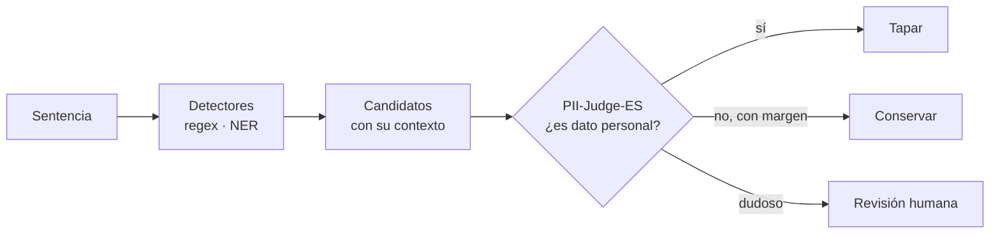

# PII-Judge-ES · prueba de concepto

**¿Puede un modelo pequeño, ejecutado en un ordenador normal, decidir si lo que un detector ha marcado como «dato personal» en una sentencia lo es de verdad?**

Las herramientas que ocultan datos personales en documentos jurídicos se pasan de prudentes: tapan «Cuenca» cuando es solo una ciudad, tapan números de expediente como si fueran DNI, y dejan el texto ilegible. Corregirlo a mano cuesta horas. Esta prueba de concepto investiga si un **validador neuronal de menos de 100 MB** puede quitar al menos una cuarta parte de esas falsas alarmas **sin dejar escapar más de 1 de cada 100 datos personales verdaderos**.

!!! info "Qué es esto"
    Un trabajo **exploratorio, independiente, cerrado y fechado**, hecho con fondos propios por una persona. Todo el proceso se documenta aquí en tiempo real: lo que se hace, lo que se decide y lo que se aprende, incluidos los fallos. Al cerrar, el repositorio se archiva.

    [Protocolo preregistrado](protocolo.md) · [Bitácora](blog/index.md) · [Decisiones](decisiones/index.md) · [Aprende](guia/index.md) · [Repositorio](https://github.com/noelserdna/pii-judge-es-poc)

## Panel de progreso

_Última actualización: 7 de noviembre de 2026 (chequeo de realidad)._

!!! warning "Pendiente de un tercero"
    El uso de sentencias del CENDOJ para construir el conjunto anotado (Paso 3a) espera la autorización de reutilización del CENDOJ ([ADR-013](decisiones/ADR-013-autorizacion-cendoj.md)). Los demás pasos siguen adelante.

### Criterios de éxito preregistrados — 0 / 3

| Criterio | Umbral | Resultado | Veredicto |
|---|---|---|---|
| C1 · Falsos positivos eliminados | ≥ 25 % (cota inferior IC 95 %) | — | ⚪ sin datos |
| C2 · Falsos descartes | ≤ 1 % puntual y cota superior CP 95 % ≤ 2,5 % | — | ⚪ sin datos |
| C3 · Mejora sobre regresión logística | ≥ 5 puntos, IC pareado > 0 | — | ⚪ sin datos |

Leyenda: ⚪ sin datos · 🟢 pasa · 🟡 no concluyente · 🔴 no pasa. Los criterios exactos están en el [protocolo](protocolo.md).

### Pasos

| # | Paso | Previsto | Real | Estado |
|---|---|---|---|---|
| 0 | Proyecto, repo, chequeo de realidad y preregistro | 7–10 nov | — | 🔵 en curso |
| 1 | Guía de anotación v1 | 11–12 nov | — | ⚪ pendiente |
| 2 | Detector de alta sensibilidad + Presidio | 12–14 nov | — | ⚪ pendiente |
| 3 | Datos: CENDOJ, sintéticos, candidatos, anotación | 15–24 nov | — | ⚪ pendiente |
| 4 | Congelado de etiquetas | 25 nov | — | ⚪ pendiente |
| 5 | Sonda y baselines | 26 nov | — | ⚪ pendiente |
| 6 | Entrenamiento | 27–28 nov | — | ⚪ pendiente |
| 7 | Evaluación | 29 nov – 1 dic | — | ⚪ pendiente |
| 8 | Informe y cierre | 3–4 dic | — | ⚪ pendiente |

### Datos y anotación

| Indicador | Valor | Objetivo |
|---|---|---|
| Sentencias del chequeo de realidad (solo local) | 10 | 10 |
| Sentencias CENDOJ para el conjunto anotado | 0 | ~25 |
| Familias sintéticas | 0 | 10–12 |
| Grupos anotados (1 mención por grupo, [ADR-012](decisiones/ADR-012-unidad-de-anotacion.md)) | 0 | ~1.700 |
| Ambiguos excluidos | — | < 5 % |
| Positivos en el conjunto de test | 0 | ≥ 500 |
| Acuerdo entre anotaciones (κ) | — | ≥ 0,6 |

### Hitos fechados

| Hito | Tag | Fecha | DOI |
|---|---|---|---|
| Protocolo cerrado | `preregistro` | — | — |
| Guía de anotación cerrada | `guia-v1` | — | — |
| Etiquetas congeladas | `anotacion-congelada` | — | — |
| Informe final | `poc-v1` | — | — |

### Guía didáctica — 0 / 9 capítulos

Ver [Aprende](guia/index.md).

### Esfuerzo

| Horas acumuladas | Coste acumulado |
|---|---|
| 10 h | 0 € |

Fuente: [`horas.csv`](https://github.com/noelserdna/pii-judge-es-poc/blob/main/horas.csv) y [`costes.csv`](https://github.com/noelserdna/pii-judge-es-poc/blob/main/costes.csv).

## Cómo funciona, en un dibujo

El validador **no busca** datos personales: solo juzga los que los detectores ya han encontrado. Por eso nunca puede recuperar lo que un detector no vio, y por eso la métrica que más importa es cuántos datos personales verdaderos descarta por error.
